<!-- GitHub Profile README | Karl Bucad -->
<!-- Banner assets generated with mikewall.dev/tools/github-banners. Keep both SVGs in art/. -->

  <picture>
    <source media="(prefers-color-scheme: dark)" srcset="art/header-dark.svg" />
    
  </picture>

<h1 align="center">Hey there, I'm Karl </h1>

<!-- Custom typing animation: continuous lines, then a final pause before repeating. -->
<!-- Keep art/typing-intro.svg in the repository alongside the banner assets. -->

  

  
  
  

 

<h2 align="center">✦ About Me</h2>

<table align="center" width="100%">
  <tr>
    <td width="65%" valign="top">
      
I'm a <b>Computer Science student at Michigan State University</b> who enjoys turning ideas into practical software.

      
My interests span <b>full-stack development, software engineering, and AI</b>. I like building products end-to-end, learning new tools, and solving problems that matter to real users.

      
🔭 <b>Building:</b> ShopLens, a project focused on TikTok Shop affiliate analytics.

      
🧠 <b>Exploring:</b> AI integrations, backend systems, and scalable applications.

      
🎓 <b>Studying:</b> B.S. in Computer Science at MSU · Expected Spring 2028.

      
💡 <b>Enjoy:</b> Bringing together product thinking, data, and engineering.

    </td>
    <td width="35%" align="center" valign="middle">
      
    </td>
  </tr>
</table>

 

<h2 align="center">⚡ Tech Stack</h2>

<b>Languages</b>

  

<b>Frameworks & Tools</b>

  

 

<h2 align="center">🚀 Featured Projects</h2>

  
  

  
  

  <b>ShopLens:</b> Next.js · FastAPI · PostgreSQL &nbsp; | &nbsp; <b>AveloHealth:</b> Hackathon project · AI integrations 
  <b>Internship Tracker:</b> React frontend &nbsp; | &nbsp; <b>C++ Cryptocurrency Parser:</b> CSV data processing

 

<h2 align="center">📈 GitHub Activity</h2>

  
  

  

 

<h2 align="center">🐍 Contribution Snake</h2>
<!-- Generated daily by .github/workflows/snake.yml and published to the output branch. -->

  <picture>
    <source media="(prefers-color-scheme: dark)" srcset="https://raw.githubusercontent.com/karl-bucad/karl-bucad/output/github-contribution-grid-snake-dark.svg" />
    
  </picture>

 

<h2 align="center">🤝 Connect With Me</h2>

  
  
  <!-- Add an email badge after choosing the email address you want to publish publicly. -->
  <!-- Optional social badges: X, Instagram, TikTok, and YouTube can be added when you want to share their handles. -->

 

  

